# cyberspace-g2

A [Cyberspace](https://cyberspace.online) client for the Even Realities G2 smart glasses. It brings the feed, cIRC chat rooms, C-Mail, notifications and notes to the glasses display, with voice replies through the G2 microphone and a companion view on the phone.

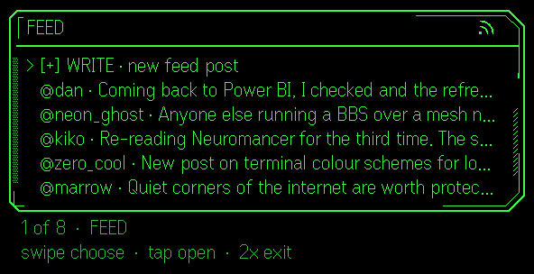

## Contents

- [Features](#features)
- [Screenshots](#screenshots)
- [Requirements](#requirements)
- [Getting started](#getting-started)
- [Usage](#usage)
- [Speech-to-text configuration](#speech-to-text-configuration)
- [Permissions and privacy](#permissions-and-privacy)

## Features

On the glasses:

- Feed: recent posts, each post with its replies, and new posts written by voice.
- cIRC: chat rooms with their online counts. Rooms open at the latest messages and page back through the history.
- C-Mail: direct message threads, also opened at the latest message.
- Inbox: replies, mentions, likes, follows and saved entries.
- Notes: your Cyberspace notes.
- Voice replies in cIRC rooms and C-Mail threads, and new feed posts by voice. Speech is transcribed by a provider of your choice and reviewed on the glasses before anything is sent.

On the phone:

- Log in to your Cyberspace account. The session is kept between launches.
- A terminal-style view of the same sections, with a live mirror of the glasses display.
- Speech-to-text settings: provider, API key, model and language.

## Screenshots

Captured from the G2 display with demo data.

| Feed | Post |
|---|---|
| 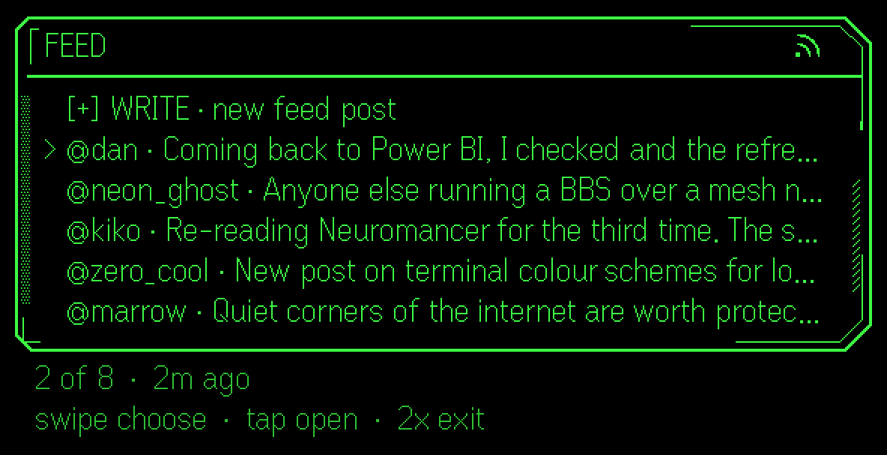 | 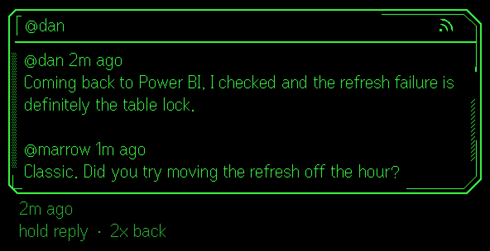 |
| cIRC | cIRC room |
| 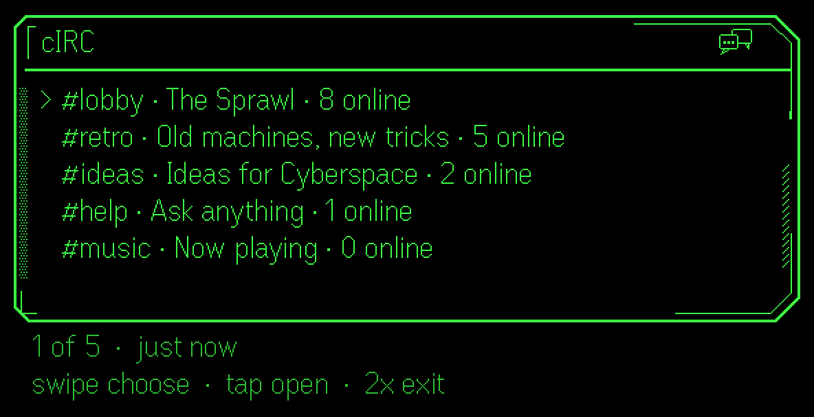 | 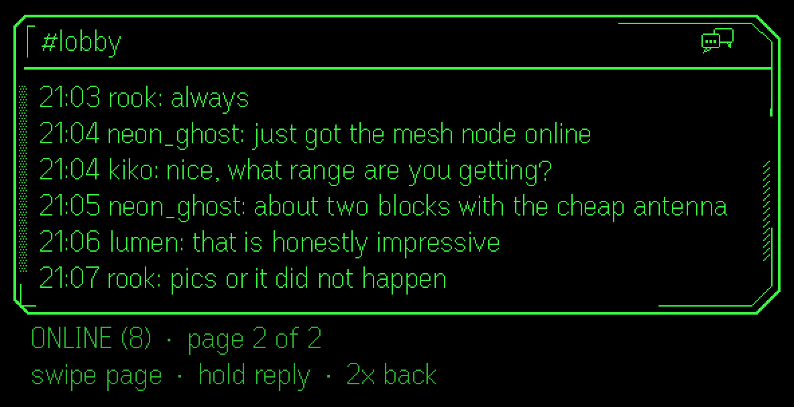 |
| C-Mail | C-Mail thread |
| 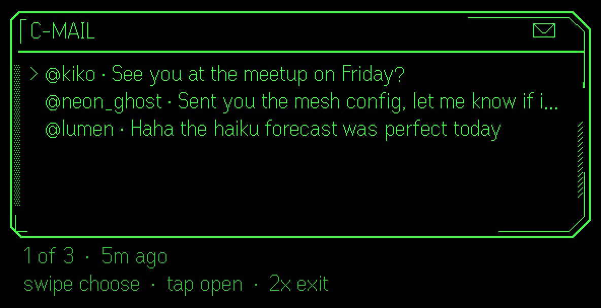 | 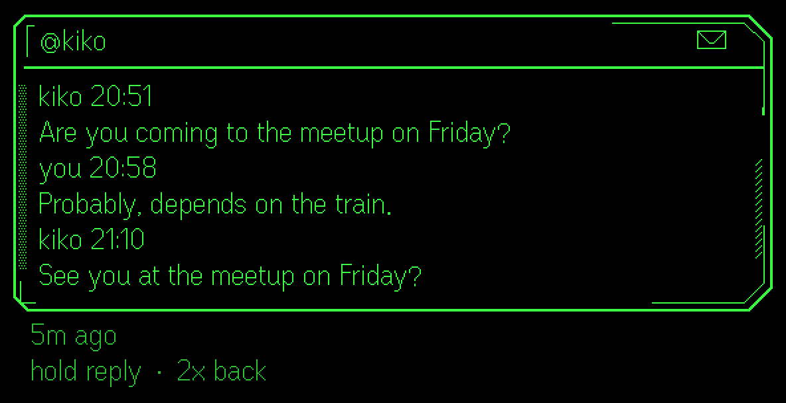 |
| Recording a reply | Reviewing the transcript |
| 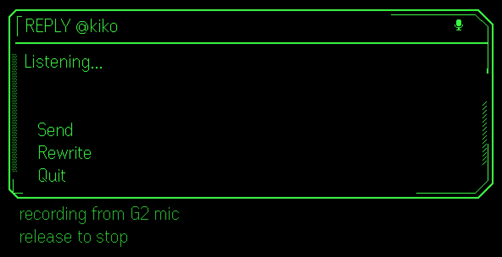 | 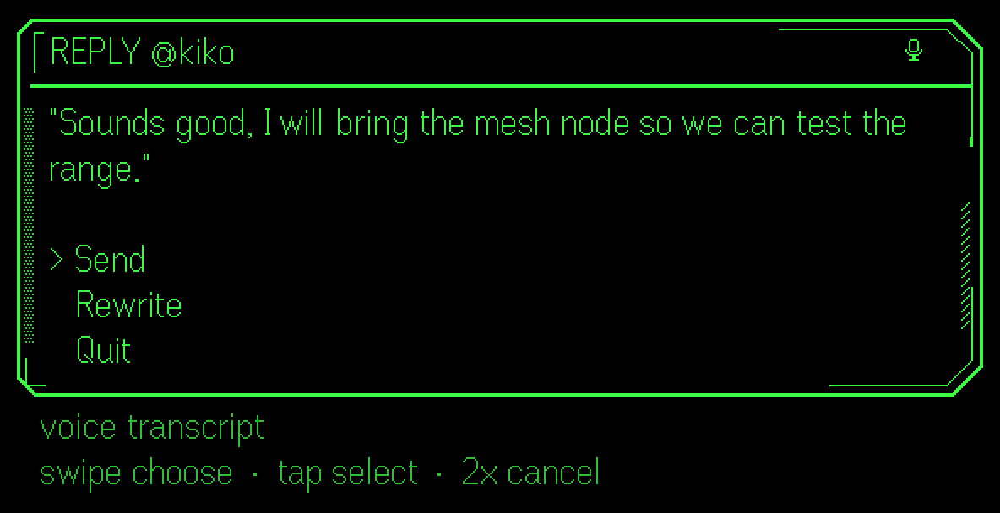 |
| Inbox | Notes |
| 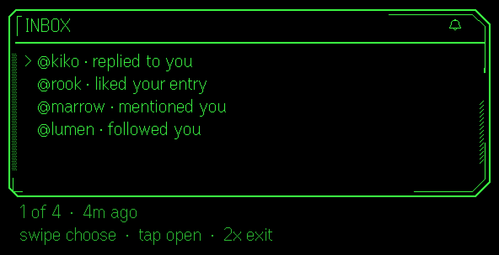 | 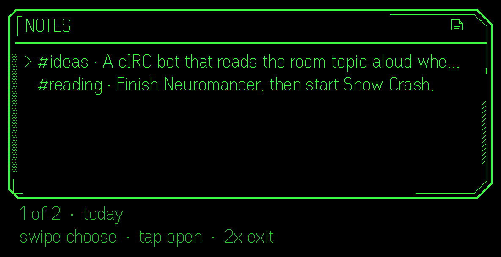 |
| Logged out | |
| 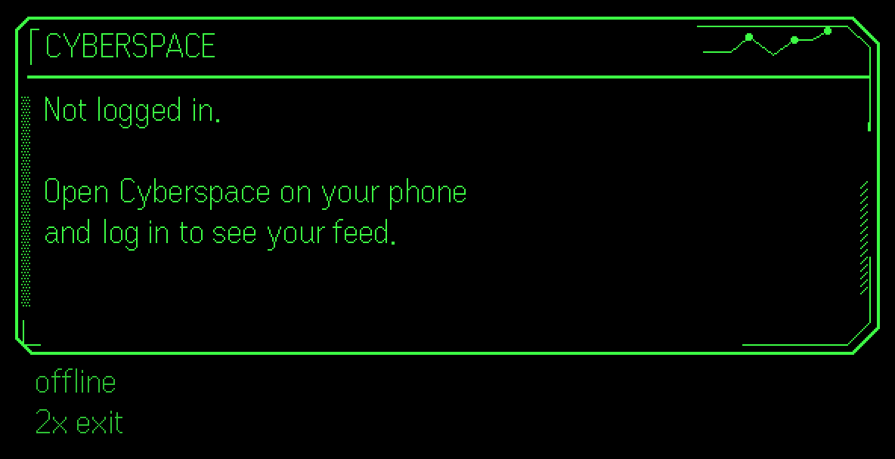 | |

## Requirements

- Node.js 20.19+ or 22.12+
- A Cyberspace account, except in demo mode
- For voice replies, an API key from a supported speech-to-text provider
- To run it on hardware: Even Realities G2 glasses and the Even Realities app

## Getting started

Install the dependencies and start the development server:

```sh
git clone https://github.com/ARCANGEL0/cyberspace-g2.git
cd cyberspace-g2
npm install
npm run dev
```

In a second terminal, open the app in the Even Hub simulator:

```sh
npx evenhub-simulator http://localhost:5173
```

Log in from the phone view in the simulator window.

### Demo mode

Demo mode fills every section with sample data, so no account or network is needed. It is only available in development builds.

```sh
npx evenhub-simulator "http://localhost:5173/?demo"           # sample feed, rooms, mail, inbox and notes
npx evenhub-simulator "http://localhost:5173/?demo=offline"   # logged-out screen
```

### Production build

```sh
npm run build
```

This type-checks the project and writes the production bundle to `dist/`. Demo mode is not included.

## Usage

### Controls

The temple touchpads and the R1 ring use the same gestures.

| Gesture | Lists | Posts and chats | Reply |
|---|---|---|---|
| Swipe | Move the cursor | Previous or next page | Choose Send, Rewrite or Quit |
| Tap | Open the selected item, or `[+] WRITE` for a new post | | Confirm the choice |
| Double tap | Exit the app (with confirmation) | Back to the list | Cancel the reply |
| Hold | Reply by voice (cIRC, C-Mail) | Reply by voice (cIRC, C-Mail) | Record while held |
| Tap, then hold | Open the section menu | | |

### Sections

The section menu switches between Feed, cIRC, C-Mail, Inbox and Notes. The icon in the top-right corner of the card shows the current section, and the line under the card shows your position in the list and what each gesture does.

### Voice replies

1. Hold the touchpad and speak. The microphone icon fills while recording.
2. Release to stop. The transcript appears on the card.
3. Choose Send to post it, Rewrite to discard it and record again, or Quit to leave without posting.

Nothing is posted until Send is confirmed.

## Speech-to-text configuration

The G2 records audio but does not transcribe it, and Cyberspace has no transcription service, so voice replies use an external provider with your own API key. Settings are on the phone, behind the gear icon in the top-right corner.

| Setting | Description |
|---|---|
| Provider | One of the built-in providers, Custom, or off |
| API key | The provider's key, stored on the phone only |
| Model | Optional; the provider's default is used when empty |
| Language | Optional ISO 639-1 code such as `en`; detected automatically when empty |
| Endpoint URL | Custom only: the URL of an OpenAI-compatible transcription endpoint |

Built-in providers: OpenAI, Groq, Deepgram, ElevenLabs, Mistral, Together AI, Hugging Face, Lemonfox, AssemblyAI, Gladia and Speechmatics.

Where to get each key, the default models, and how to set up a custom endpoint are covered in [docs/stt.md](docs/stt.md).

## Permissions and privacy

| Permission | Used for |
|---|---|
| Network | `api.cyberspace.online`, and the speech-to-text provider you configure |
| G2 microphone | Recording voice replies while the touchpad is held |

- The app connects only to the origins listed in `app.json`: the Cyberspace API and the built-in speech-to-text providers.
- Recordings are sent only to the provider you selected, and only after you release the touchpad.
- Your session and API key are stored on your phone. Logging out removes the session.

<div align="center">

## ❤️ Support

 ### if you enjoy the project and want to support future development:

[](https://github.com/ARCANGEL0/cyberspace-g2)
[](https://github.com/ARCANGEL0)
<br>

<a href='https://ko-fi.com/J3J7WTYV7' target='_blank'></a>
<br>
<strong>Hack the world. Byte by Byte.</strong> ⛛ <br>
𝝺𝗿𝗰𝗮𝗻𝗴𝗲𝗹𝗼 @ 2026


</div>
